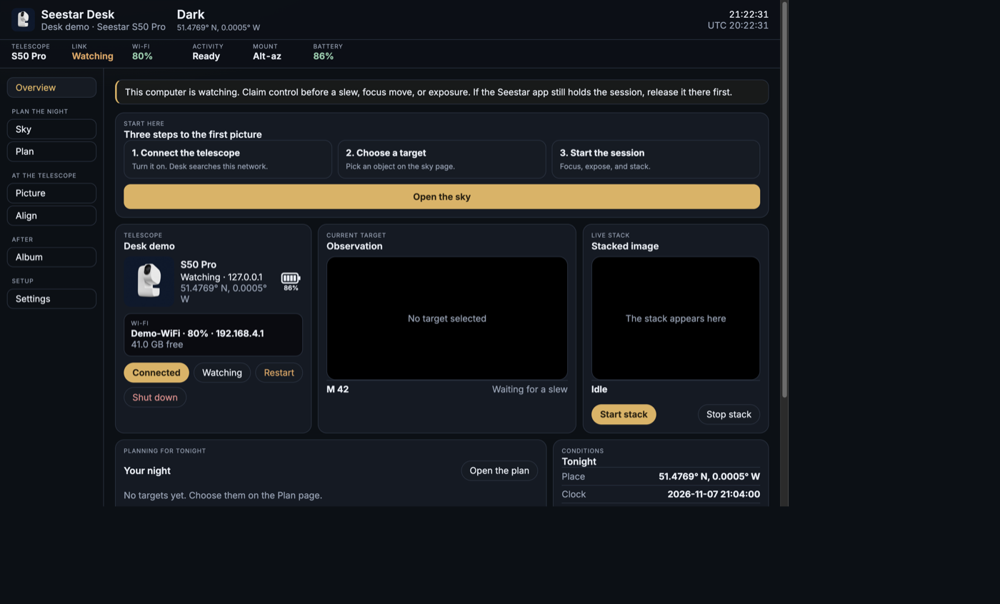
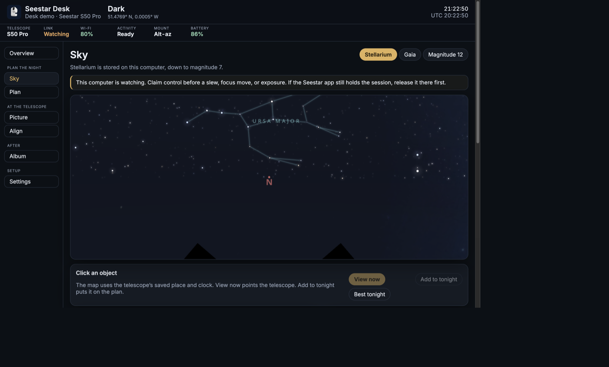
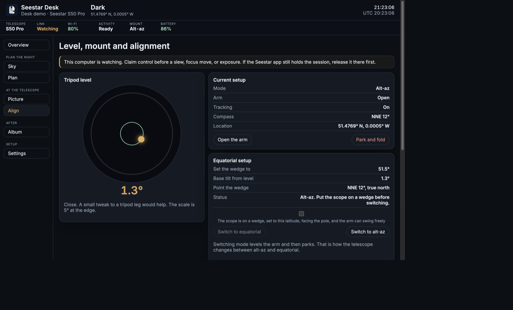

# Seestar Desk

Seestar Desk operates a ZWO Seestar (S30, S50, or S50 Pro) from any browser. A small Python program talks to the telescope and serves the page. It can run on this computer or, with Docker Compose, on a Docker host on the same network. Solar imaging and firmware updates stay in the official Seestar app.

You need Python 3.11 or newer, and the telescope on the same network as this computer.

## Screenshots

These are the demo telescope. A connected Seestar fills in the same pages with its own status.







## Start

From this folder:

```bash
# macOS or Linux
./seestar-desk.py

# Windows
py seestar-desk.py
```

The first start installs the Python packages if they are missing. The desk opens at http://127.0.0.1:8731/.

Useful options:

```bash
./seestar-desk.py --demo          # simulated S50 Pro, no telescope required
./seestar-desk.py --no-browser    # start the server and leave the browser closed
./seestar-desk.py --host 0.0.0.0  # reach the page from another device on your network
./seestar-desk.py --port 8731
```

Stop it with Ctrl+C in that terminal.

## Docker Compose

Use this when the desk should run on a Docker host instead of a local server on the PC or Mac. The Docker host has to be on the same network as the telescope. Open the page from any browser at `http://<docker-host>:8731/`.

Clone the repository, put the signature key where the container can read it, then build and start:

```bash
git clone https://github.com/bertvm/seestar-desk.git
cd seestar-desk
mkdir -p docker-data
cp /path/to/seestar.pem docker-data/seestar.pem
chmod 600 docker-data/seestar.pem
docker compose up -d --build
```

When you want a newer desk, pull the repository and build again. There is no public `seestar-desk` image, so `docker compose pull` fails and is not part of an update.

```bash
git pull
docker compose up -d --build
```

The service uses the Docker host's own network, so telescope discovery still works. The container is named `seestar-desk`. Remembered telescopes are stored in `docker-data/.seestar-desk/scopes.json`. Stars kept for the magnitude 12 chart are stored in `docker-data/.seestar-desk/stars`. Album copies are stored in `docker-data/Pictures/Seestar Desk`. `docker-data/` is not committed. The signature key is a file beside that folder, not inside the image. See [The signature key](#the-signature-key).

```bash
docker compose logs -f
docker compose stop
docker compose down
```

If the overview does not list the telescope, add it by its IP address.

## Use

1. Turn the Seestar on and join its Wi-Fi, or put the telescope and this computer on the same home network.
2. Open the desk. Overview lists telescopes it finds. Press **Connect**. Press **Connected** to disconnect.
3. The control button shows **Watching** or **In control**. Press it to take or release the session. On current S50 Pro firmware the telescope does not lock the session; the button still shows which state the desk is in.
4. Open a section from the left:
   - **Overview** shows the connected telescope, battery, Wi-Fi, storage, firmware, temperature, coordinates, and tonight’s plan.
   - **Sky** is the star chart for the saved place and the telescope clock. **Stellarium** is stored on this computer, down to magnitude 7. **Gaia** adds fainter stars from the internet. **Magnitude 12** keeps stars from magnitude 8 through 12 on this computer after the map first asks for them, in `~/.seestar-desk/stars`. **Best tonight** ranks catalog objects for the dark hours ahead. Go to a target, or add it to the plan.
   - **Picture** opens the live view. Choose the telephoto or wide camera, nudge, focus, change the filter, start or stop a stack, run a mosaic, or record a planet, the Moon, or scenery. **Play on TV** opens a full-screen page for Chromecast or AirPlay. The TV has to be able to open the desk’s address, so cast from the Docker host or another machine on the network, not from `127.0.0.1`. Parking clears the picture and stops the stream.
   - **Align** is the level, the mount, and polar alignment. The bubble is the tripod tilt, with 5° at the edge. In equatorial mode the page compares that tilt with the latitude. Switch to equatorial only after confirming the scope is on a wedge, facing the pole, with room for the arm to swing. **Measure polar error** runs the three-point alignment. **Measure here** reads the error without moving to a new declination. **Live adjust** repeats that reading every 5 seconds. **Park and fold** closes the arm and can power the telescope down.
   - **Album** lists saved sessions. Select files, copy them, and optionally delete them from the telescope afterwards. Copies land in `~/Pictures/Seestar Desk`.
   - **Plan** is the night's list. It shows altitude, twilight, and cloud cover, then slews, focuses, and stacks each target. It skips a target that is too low, a battery that is too low, dawn, or heavy cloud. Parking at the end is off unless you tick it.
   - **Settings** holds the theme (Night, Slate, Pine, or Daylight), the saved place, the telescope clock, the dew heater, Wi-Fi, and power. Set the location before Plan or Best tonight can judge altitude and darkness.
5. **Restart** and **Shut down** ask for confirmation, then power-cycle or turn off the telescope.

The desk remembers telescopes in `~/.seestar-desk/scopes.json`. On a Docker host that file is `docker-data/.seestar-desk/scopes.json`.

## The signature key

Current firmware ignores a client until that client signs a short challenge. The signing key is one key shared by the official Seestar app. It is the same for every Seestar. The telescope holds only the matching public key and sends a fresh challenge each time you connect. Seestar Desk does not include the key.

If the telescope says “please update to the latest application”, it has not accepted the signature yet.

The desk looks for a PEM file in this order and uses the first one it finds:

1. The path in the `SEESTAR_KEY_PATH` environment variable.
2. `seestar.pem` in the folder where you started the desk.
3. `~/.seestarpy/seestar.pem`
4. `~/.seestar-desk/seestar.pem`
5. The Seestar app on this Mac, at `/Applications/Seestar.app` or `~/Applications/Seestar.app`.

### Add the key to Docker

Inside the container the desk reads `/data/seestar.pem`. That path is the file `docker-data/seestar.pem` on the host. A rebuild does not need to happen after the file is in place. The next connection uses it.

On the Docker host, from the `seestar-desk` folder:

```bash
mkdir -p docker-data
cp /path/to/seestar.pem docker-data/seestar.pem
chmod 600 docker-data/seestar.pem
```

From another computer, create the folder first, then copy the file. Copying straight into a missing `docker-data` folder fails.

```bash
ssh user@docker-host 'mkdir -p ~/seestar-desk/docker-data'
scp seestar.pem user@docker-host:~/seestar-desk/docker-data/seestar.pem
ssh user@docker-host 'chmod 600 ~/seestar-desk/docker-data/seestar.pem'
```

Change `user`, `docker-host`, and `~/seestar-desk` to the account, address, and folder you actually use.

If the PEM is already on the host, for example in your home directory, this puts it in the running container. The Compose volume keeps it at `docker-data/seestar.pem`.

```bash
docker cp ~/seestar.pem seestar-desk:/data/seestar.pem
docker exec seestar-desk chmod 600 /data/seestar.pem
```

Use the container’s real name if it is not `seestar-desk`. Check with `docker ps`.

Do not commit this file. `docker-data/` and `*.pem` are gitignored.

### No Seestar app on this computer

Download the official Seestar Android package (`.apk` or the APK inside an `.xapk`) from ZWO. Then, from this folder:

```bash
./seestar-desk.py --help
python3 -m seestar_desk.extract_pem path/to/seestar.apk
```

That writes `~/.seestar-desk/seestar.pem` and limits it to your user account. An `.xapk` is a zip of APKs; point the command at the inner `.apk`. If the telescope still asks you to update, repeat the command with the newest package from ZWO.

You can also place a PEM you already extracted at any of the paths above:

```bash
# macOS or Linux
export SEESTAR_KEY_PATH="$HOME/somewhere/seestar.pem"

# Windows PowerShell
$env:SEESTAR_KEY_PATH = "$HOME\somewhere\seestar.pem"
```

Do not commit the PEM, and do not send it with a bug report. `*.pem` is listed in `.gitignore`.
